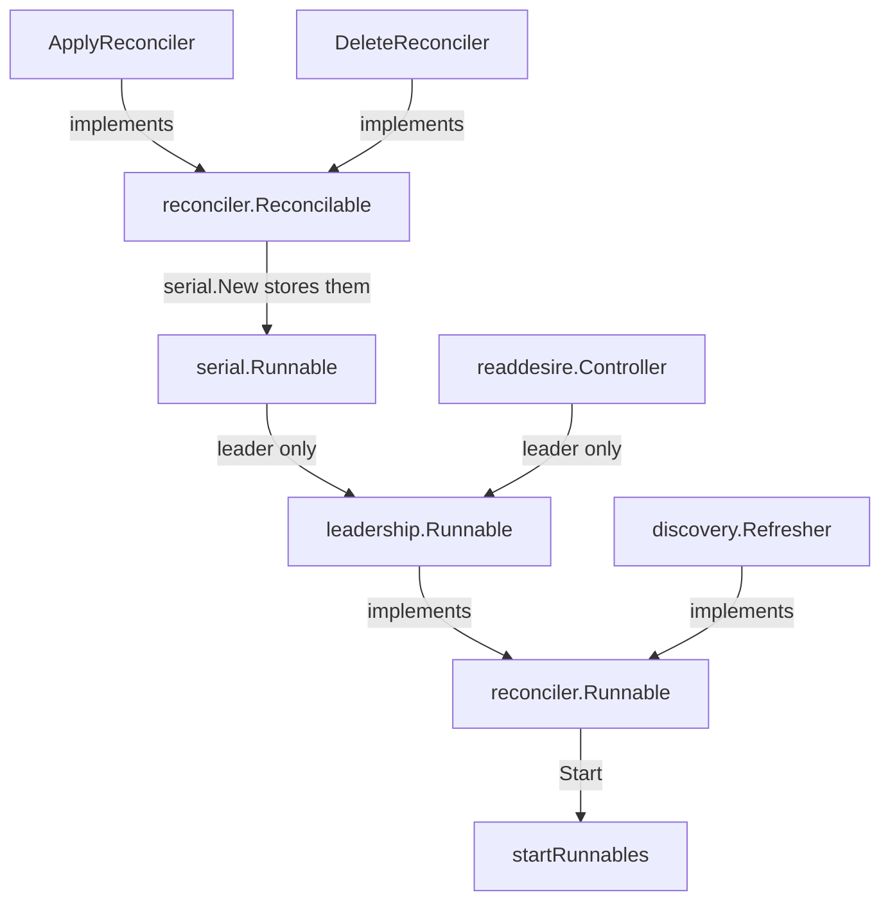

# internal/reconciler

`Runnable` and `Reconcilable` are the two lifecycles the applier starts.

`serial.New` returns `*serial.Runnable`. `readdesire.New` returns `*Controller`.
Both implement `Runnable`, but `leadership.Runnable` starts them only after acquiring
the management-cluster Lease. Losing the Lease cancels their contexts and waits for
both to stop before returning an error, causing the service to exit.
`startRunnables` starts the election wrapper and `discovery.Refresher` on every
replica. `serial.Runnable.Start` calls `RunOnce` on apply, then delete.
